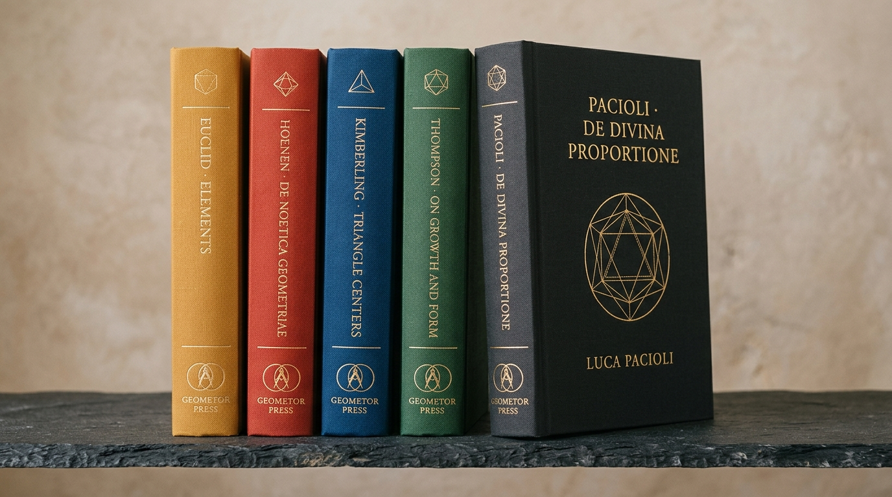

GEOMETOR • press
================

**Visit the Online Archive:** https://geometor.github.io/press/

**GEOMETOR Press • Master shelf manifest, typographic system & collector editions**

Mission
-------

``geometor/press`` is part of the interconnected `GEOMETOR <https://geometor.com>`_ semantic digital archive. It serves as the editorial, typographic, and physical artifact headquarters of the GEOMETOR initiative—organizing the complete corpus of book codices, mathematical catalogs, parametric vector diagrams, and archival folios into a unified five-spine series of fine print editions, EPUB 3.3 codices, collector card decks, and museum broadsides.

Capabilities & Interactive Docs
-------------------------------

- `GEOMETOR Press <https://geometor.github.io/press/>`_ — Central publishing house, master shelf manifest, and imprint identity.
- `Brand & Spine Series System <https://geometor.github.io/press/brand/>`_ — The Five Mineral Spine Series, *Vesica-to-* :math:`\phi` colophon, and Aldine page canons.
- `Shelf Readiness Manifest <https://geometor.github.io/press/manifest/>`_ — Comprehensive multi-format product matrix across books, e-books, card decks, and broadsides.
- `Visual Lookbook Plates <https://geometor.github.io/press/lookbook/>`_ — High-resolution concept plates for clothbound covers, foiled spine shelves, and tactile objects.
- `Interactive Parametric Studios <https://geometor.github.io/press/studios/>`_ — Live browser workbenches for parametric SVG cover generation and 3D collector cards with SVG export.

Repository Contents
-------------------

- ``docsrc/`` — RST technical documentation, brand guides, and lookbook compiled by `PHOTON publish <https://github.com/photon-platform/publish>`_.
- ``resources/`` — Canonical machine-readable shelf manifests (``shelf.yaml``, ``shelf.json``) and workspace census.
- ``src/geometor/press/`` — Python CLI, typed shelf models, and workspace census scanners.

Local Build & Verification
--------------------------

.. code-block:: bash

   publish build
   uv run --no-sync pytest

Part of the GEOMETOR Knowledge Archive
--------------------------------------

Explore all **74 Book Codices** and **11 Mathematical Catalogs** at https://geometor.com/books/.
